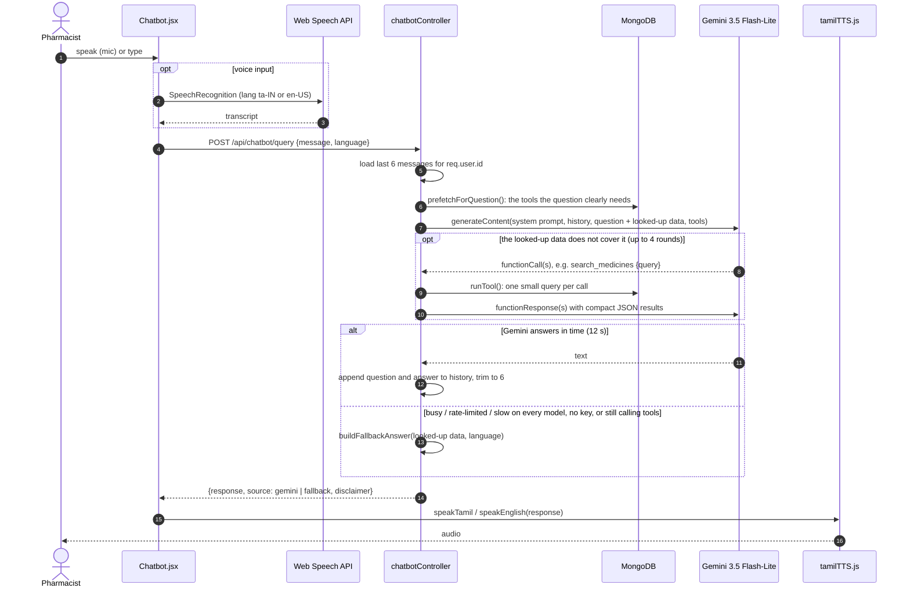

# Voice Assistant (Chatbot)

> **TL;DR** — A floating chat widget (`Chatbot.jsx`) takes typed or spoken questions in **English or Tamil**, sends them to `POST /api/chatbot/query`, and reads the answer aloud. The server first **looks up what the question names** (medicines, including brand names and Tamil spellings; low stock; expiry; sales) and sends that data with the question to **Gemini 3.5 Flash-Lite**, so most questions are answered in **one model call**. The model can still call five read-only **inventory tools** for anything else. A busy or slow model is retried on a second model, and if no answer arrives within **12 s** the server **answers directly from the looked-up data**, with the same stock rules. The last 3 exchanges per user are kept as memory. The API key never leaves the server.

---

## 1. Request flow

---

## 2. Prompt, lookups and tools

**System instruction** (`buildSystemPrompt`, sent in Gemini's `systemInstruction` field). It carries no inventory data, only today's date (IST) and the directives:

1. Answer from the looked-up data when it is there; otherwise, or for anything it doesn't cover, use the tools (several in one turn if needed). Never guess stock, prices, racks or dates.
2. A medicine is in stock **only** if it has an active batch (`inStock: true`); say so when its stock has expired.
3. If it's unavailable, suggest in-stock medicines of the same category.
4. Always state the **rack number** of the batch to use first (earliest expiry) when confirming stock.
5. Keep a clinical tone; **no medical advice** (dosage, diagnosis), inventory questions only.
6. **Plain text** (the widget shows text as-is, so no Markdown), `•` for lists, at most 6 short lines, no greetings.
7. Respond in Tamil or English, following the `language` field.

**Lookups before the model call** (`server/services/chatbotPrefetch.js`). Each extra tool round trip costs another slow, rate-limited Gemini request, so the server runs the obvious lookups itself and appends the results to the question:

| The question… | Looked up |
|---|---|
| names a medicine (exact, a 4+ letter prefix like "amox", a small typo like "paracetmol", a **brand** like "Dolo 650" → paracetamol, or **Tamil script** like "பாராசிட்டமால்") | `search_medicines` for up to 3 names, plus `find_alternatives` for any that can't be sold |
| mentions low stock / reorder / குறைந்த | `list_low_stock` |
| mentions expiry / காலாவதி (with "N days" if given) | `list_expiring_batches` |
| mentions summary / sales / விற்பனை | `get_inventory_summary` |
| names nothing but points back ("and **its** rack?", "அதன் விலை?") | the medicines named in the previous question |

Tamil names are matched by a **sound skeleton**: vowels dropped, voiced and unvoiced consonants in one class, repeats collapsed. "பாராசிட்டமால்" and "paracetamol" both become `prstml`. Brand names come from a short table (`BRAND_TO_GENERIC`). Only medicine **names** are read to find matches; the full records are fetched only for the matches.

**Tools** (`server/services/chatbotTools.js`). All are read-only, run one small query, and return at most 15 medicines or batches (with `truncated` and `total` when there are more). Stock and expiry follow the app's shared rules (`utils/stockLevel.js`, `utils/expiry.js`): an **active batch** has stock left and hasn't expired (from 00:00 IST on its expiry day).

| Tool | Arguments | Returns |
|------|-----------|---------|
| `search_medicines` | `query` (part of the name), optional `category` | Matching medicines: `inStock`, `sellableQuantity`, expired stock still on the shelf, total quantity, reorder level, stock level, price, active batches (batch, rack, quantity, expiry, days left; earliest first) |
| `find_alternatives` | `category`, optional `exclude` (name) | In-stock medicines of that category, most stock first |
| `list_low_stock` | — | Medicines at or below their reorder level, most urgent first |
| `list_expiring_batches` | optional `days` (1–180, default 30) | Batches with stock that have expired or expire within the window, soonest first, with racks |
| `get_inventory_summary` | — | Counts (medicines, low stock, medicines with expired stock), categories, today's sales (from 00:00 IST) |

**The loop** (`callGeminiAPI`). The model replies either with text (the answer) or with one or more `functionCall`s. The server runs every call (`runTool`, which never throws: an unknown tool or a failed query comes back as `{ error }`), appends the model's turn and the `functionResponse`s, and asks again. After 4 rounds of tool calls without an answer it gives up and the offline answer is used. Each answer is logged with its time, the models used, what was looked up and any retries.

**Models, retries and time limits.** `GEMINI_MODELS` (default `gemini-3.5-flash-lite,gemini-flash-lite-latest`) are tried in order; different models have separate free-tier quotas.

| Situation | What happens |
|---|---|
| 503 (busy), 429 (quota), 5xx, 404 (model retired), network error | The same request goes to the next model at once |
| No reply after **4 s** | The same request also goes to the next model; the first answer wins and the other request is cancelled |
| A call runs **10 s** | It is abandoned |
| No answer **12 s** after the question arrived | The offline answer is used |
| 400 / 401 / 403 (bad request or key) | Not retried: it would fail on every model |

**Generation config:** `temperature 0.3` (factual, low creativity), `maxOutputTokens 600`, `topK 40`, `topP 0.95`.

**Measured (live, 23 Nov 2026, free tier, 11 questions in English and Tamil):**

| | Before (tools only) | Now |
|---|---|---|
| Model calls per question | 2–5 | 1 for 9 of 11 questions |
| Typical answer time | 7–20 s | 1–3 s |
| Slowest answer | 63 s (one call) | 12 s (offline answer, still correct) |
| All 11 questions | 92 s | 44 s |
| Answer when Gemini was busy | Generic "I can help with…" message, or expired stock shown as available | Correct answer from the looked-up data |

---

## 3. Conversation memory

- `userChatHistories`: an in-process `Map<userId, Array<{role, text}>>`.
- Keeps the last **6 messages** (3 exchanges) per user.
- Only the plain question and answer are stored, never tool calls or tool results, so memory stays small and each answer looks up fresh stock data.

---

## 4. Fallbacks, in layers

| Layer | Trigger | Behaviour |
|-------|---------|-----------|
| Second model | The first model is busy, rate-limited, retired or slow | The same request on the next model in `GEMINI_MODELS` (see above) |
| Offline answer (`buildFallbackAnswer`) | No answer within 12 s on any model, no API key, an empty reply, or still calling tools after 4 rounds | Built from the same looked-up data, in English or Tamil: availability with the batch and rack to use first, expired stock called out as not sellable, same-category alternatives, low-stock and expiry lists, the summary, brand-name notes. If nothing was looked up, a short help message |
| Client fallback | The backend request fails entirely | `getSmartResponse` can use a predefined keyword→answer map; the widget passes `null`, so it shows an error message instead |
| TTS fallback | No Tamil system voice | `tamilTTS.js` converts Tamil script to an English phonetic approximation and speaks it with an available voice |

The response always includes `source` (`gemini` or `fallback`) so the UI (and debugging) can tell which path answered.

---

## 5. Tamil speech

- **Speech-to-text:** browser `SpeechRecognition` / `webkitSpeechRecognition` with `lang = 'ta-IN'` or `'en-US'` (Chrome-family browsers).
- **Text-to-speech:** `speechSynthesis`. `speakTamil` first looks for a voice whose `lang` or name matches Tamil (`ta`, `tam`, `tamil`). If none is found, or `usePhonetic` is set, `convertTamilToPhonetic` maps Tamil letters and syllables (`க → ka`, `கா → kaa`, …) to Latin text that an English voice can pronounce reasonably well.
- **Why:** many low-cost Android phones and older PCs in pharmacies have no Tamil TTS voice installed, and the phonetic fallback keeps voice output working on them.

---

## Design decisions

- **Retrieval by tool calls, not context stuffing or RAG.** The model asks the database for exactly what a question needs through typed, read-only tools. The prompt stays the same size however large the catalogue gets, there is no vector store to maintain, and answers always reflect live stock.
- **Server-side proxy for the LLM.** Keeps the key secret, allows auth and auditing, and lets the server add live data. See [ADR-0004](adr/0004-gemini-via-backend.md).
- **Look up first, then ask the model.** Most pharmacy questions name a medicine or a topic, so the server fetches that data itself; the model usually needs one call instead of several, and the offline answer uses the same data.
- **Race a second model instead of waiting.** The free tier is often busy; starting a second request after 4 s cuts the slow cases without doubling normal traffic.
- **Low temperature and strict directives** to reduce hallucinated stock or rack numbers.
- **Graceful degradation.** A pharmacy counter can't stall because an external AI is down, so a deterministic fallback always answers.
- **Browser speech APIs** cost nothing and add no server dependency.

## Known limitations

- **The free tier is busy.** During testing about 1 in 5 calls returned 503 or 429. The second model and the offline answer cover this, but the offline answer is templated, not conversational.
- **Name matching is heuristic.** A medicine that is only described ("something for allergies") or a brand missing from `BRAND_TO_GENERIC` goes to the model's tools, which takes more round trips.
- **Tool results are capped at 15 items**, so a broad question ("everything expiring this year") gets the first 15 and a `truncated` flag.
- **In-memory history** is lost on restart, isn't shared across instances, and grows with the number of distinct users (no eviction).
- **Prompt injection.** A user could try "ignore previous instructions". The tools are read-only inventory queries, so the most a model can be talked into is reading inventory data the user could see in the app anyway.
- **The phonetic map is partial** (common consonant-vowel combinations only) and contains a few non-Tamil characters (Telugu, Bengali and Devanagari) on the `ர` row, which should be cleaned up.

## Future improvements

- Put chat history in Redis with a TTL.
- Grow `BRAND_TO_GENERIC`, or store brand names on each medicine.
- Stream responses to the UI to reduce perceived latency.

---

## Related files

`server/controllers/chatbotController.js` · `server/services/chatbotTools.js` · `server/services/chatbotPrefetch.js` · `server/routes/chatbotRoutes.js` · `src/components/Chatbot.jsx` · `src/utils/geminiAPI.js` · `src/utils/tamilTTS.js`
