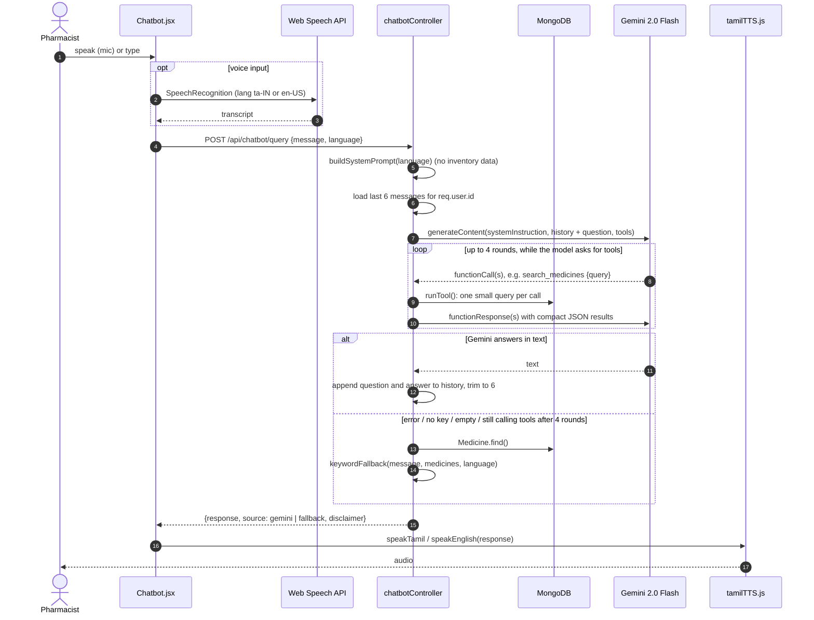

# Voice Assistant (Chatbot)

> **TL;DR** — A floating chat widget (`Chatbot.jsx`) takes typed or spoken questions in **English or Tamil**, sends them to `POST /api/chatbot/query`, and reads the answer aloud. The server calls **Gemini 2.0 Flash** with a short system instruction and five read-only **inventory tools** (function calling): the model asks for only the data a question needs (one medicine, alternatives in a category, low stock, expiring batches, a summary), and the server runs those queries and sends back compact results. The last 3 exchanges per user are kept as memory. If Gemini fails, a **keyword-based fallback** answers from the database. The API key never leaves the server.

---

## 1. Request flow

---

## 2. Prompt and tools

**System instruction** (`buildSystemPrompt`, sent in Gemini's `systemInstruction` field). It carries no inventory data, only today's date (IST) and the directives:

1. Never guess stock, prices, racks or dates: look them up with the tools.
2. A medicine is in stock **only** if it has an active batch (`inStock: true`).
3. If it's unavailable, call `find_alternatives` with its category and suggest what is in stock.
4. Always state the **rack number** of the batch to use first (earliest expiry) when confirming stock.
5. Keep a clinical tone; **no medical advice** (dosage, diagnosis), inventory questions only.
6. Respond in Tamil or English, following the `language` field.

**Tools** (`server/services/chatbotTools.js`). All are read-only, run one small query, and return at most 15 medicines or batches (with `truncated` and `total` when there are more). Stock and expiry follow the app's shared rules (`utils/stockLevel.js`, `utils/expiry.js`): an **active batch** has stock left and hasn't expired (from 00:00 IST on its expiry day).

| Tool | Arguments | Returns |
|------|-----------|---------|
| `search_medicines` | `query` (part of the name), optional `category` | Matching medicines: `inStock`, `sellableQuantity`, expired stock still on the shelf, total quantity, reorder level, stock level, price, active batches (batch, rack, quantity, expiry, days left; earliest first) |
| `find_alternatives` | `category`, optional `exclude` (name) | In-stock medicines of that category, most stock first |
| `list_low_stock` | — | Medicines at or below their reorder level, most urgent first |
| `list_expiring_batches` | optional `days` (1–180, default 30) | Batches with stock that have expired or expire within the window, soonest first, with racks |
| `get_inventory_summary` | — | Counts (medicines, low stock, medicines with expired stock), categories, today's sales (from 00:00 IST) |

**The loop** (`callGeminiAPI`). The model replies either with text (the answer) or with one or more `functionCall`s. The server runs every call (`runTool`, which never throws: an unknown tool or a failed query comes back as `{ error }`), appends the model's turn and the `functionResponse`s, and asks again. After 4 rounds of tool calls without an answer it gives up and the keyword fallback answers. Each tool use is logged (`Chatbot tools used`).

**Generation config:** `temperature 0.3` (factual, low creativity), `maxOutputTokens 600`, `topK 40`, `topP 0.95`.

**Request size.** The prompt no longer grows with the catalogue. Measured for "Do we have paracetamol?" against a mocked Gemini: with 12 medicines, the old single request was 3.8 KB and the new two requests total 6.3 KB; with 200 medicines, the old request was 35.8 KB and the new ones still 6.3 KB. The fixed part is mostly the tool declarations. The trade-off is one extra round trip to Gemini for each round of tool calls.

---

## 3. Conversation memory

- `userChatHistories`: an in-process `Map<userId, Array<{role, text}>>`.
- Keeps the last **6 messages** (3 exchanges) per user.
- Only the plain question and answer are stored, never tool calls or tool results, so memory stays small and each answer looks up fresh stock data.

---

## 4. Fallbacks, in layers

| Layer | Trigger | Behaviour |
|-------|---------|-----------|
| Server keyword fallback | Gemini throws, times out, no API key, or an empty candidate | Matches "low stock"/"reorder", "expir", or a medicine name (first word); answers in the selected language |
| Client fallback | The backend request fails entirely | `getSmartResponse` can use a predefined keyword→answer map; the widget passes `null`, so it shows an error message instead |
| TTS fallback | No Tamil system voice | `tamilTTS.js` converts Tamil script to an English phonetic approximation and speaks it with an available voice |

The response always includes `source` so the UI (and debugging) can tell which path answered.

---

## 5. Tamil speech

- **Speech-to-text:** browser `SpeechRecognition` / `webkitSpeechRecognition` with `lang = 'ta-IN'` or `'en-US'` (Chrome-family browsers).
- **Text-to-speech:** `speechSynthesis`. `speakTamil` first looks for a voice whose `lang` or name matches Tamil (`ta`, `tam`, `tamil`). If none is found, or `usePhonetic` is set, `convertTamilToPhonetic` maps Tamil letters and syllables (`க → ka`, `கா → kaa`, …) to Latin text that an English voice can pronounce reasonably well.
- **Why:** many low-cost Android phones and older PCs in pharmacies have no Tamil TTS voice installed, and the phonetic fallback keeps voice output working on them.

---

## Design decisions

- **Retrieval by tool calls, not context stuffing or RAG.** The model asks the database for exactly what a question needs through typed, read-only tools. The prompt stays the same size however large the catalogue gets, there is no vector store to maintain, and answers always reflect live stock.
- **Server-side proxy for the LLM.** Keeps the key secret, allows auth and auditing, and lets the server add live data. See [ADR-0004](adr/0004-gemini-via-backend.md).
- **Low temperature and strict directives** to reduce hallucinated stock or rack numbers.
- **Graceful degradation.** A pharmacy counter can't stall because an external AI is down, so a deterministic fallback always answers.
- **Browser speech APIs** cost nothing and add no server dependency.

## Known limitations

- **Extra round trips.** A question that needs data takes at least two Gemini calls (tool call, then answer). For a very small inventory the old full dump was smaller in bytes, but it grew with every medicine.
- **Tool results are capped at 15 items**, so a broad question ("everything expiring this year") gets the first 15 and a `truncated` flag.
- **In-memory history** is lost on restart, isn't shared across instances, and grows with the number of distinct users (no eviction).
- **Prompt injection.** A user could try "ignore previous instructions". The tools are read-only inventory queries, so the most a model can be talked into is reading inventory data the user could see in the app anyway.
- **`safetySettings` are all `BLOCK_NONE`.**
- **The API key goes in the URL query string** (`?key=`), not the `x-goog-api-key` header.
- **Keyword fallback is naive**: it matches the first word of each medicine name as a substring, e.g. "para" matches every "Paracetamol …" product.
- **The phonetic map is partial** (common consonant-vowel combinations only) and contains a few non-Tamil characters (Telugu, Bengali and Devanagari) on the `ர` row, which should be cleaned up.

## Future improvements

- Put chat history in Redis with a TTL.
- Send the key in a header; use sensible safety thresholds.
- Stream responses to the UI to reduce perceived latency.

---

## Related files

`server/controllers/chatbotController.js` · `server/services/chatbotTools.js` · `server/routes/chatbotRoutes.js` · `src/components/Chatbot.jsx` · `src/utils/geminiAPI.js` · `src/utils/tamilTTS.js`
