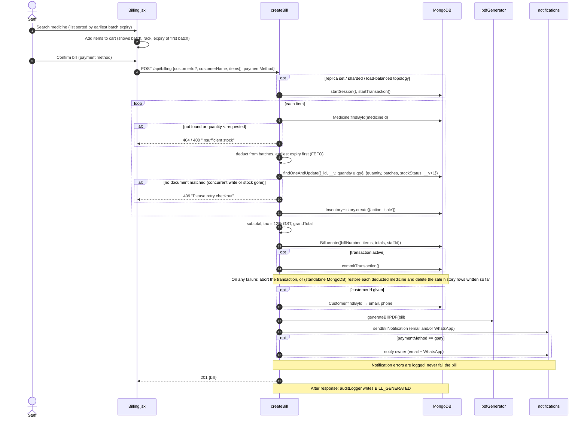
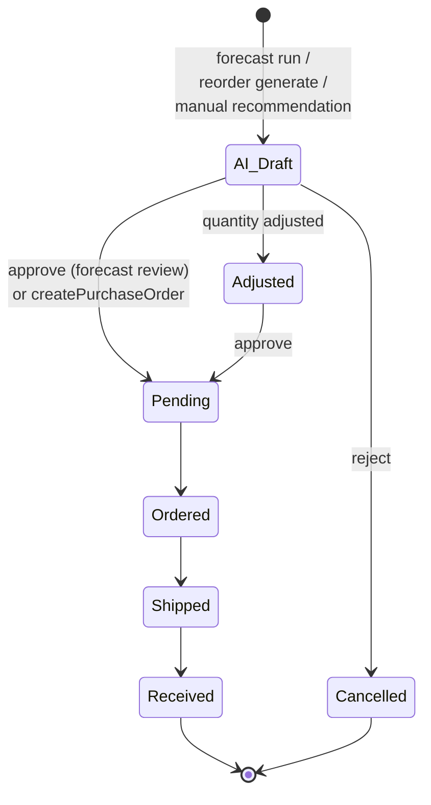
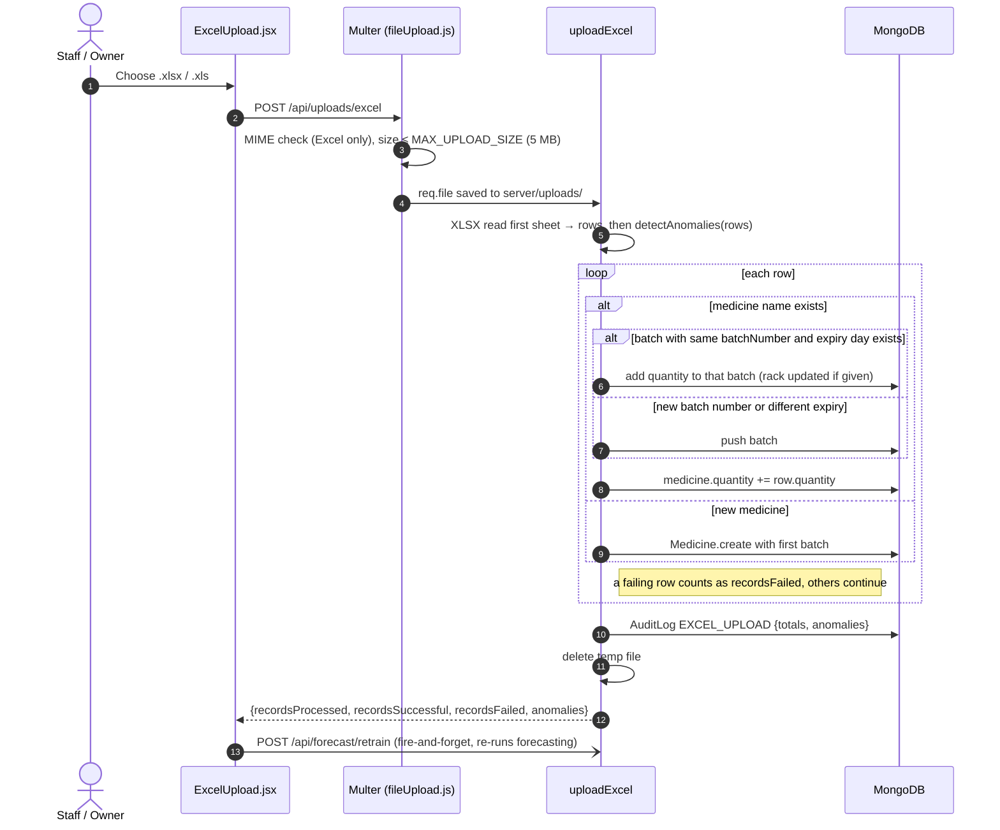
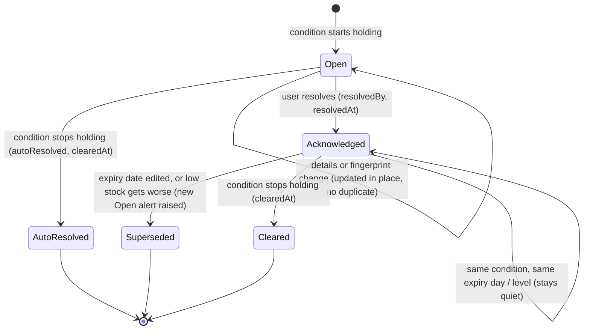

# Core Flows

> **TL;DR** — Four flows carry most of the business value: **billing** (sell stock, record history, notify), **forecast → purchase order** (predict demand, draft POs, human review), **purchase order fulfilment** (receive stock as a new batch, score the supplier), and **Excel import** (bulk-load batches). Each is described below with a sequence or state diagram and its edge cases.

---

## 1. Billing

`POST /api/billing` → `billingController.createBill`



**How FEFO shows up today**

| Where | What happens |
|-------|--------------|
| `GET /api/inventory` | Computes each medicine's earliest batch expiry and returns medicines sorted by it (`sortByFEFO`) |
| `Billing.jsx` | Re-sorts by the first batch's expiry and shows that batch's number, rack and expiry, with a "select nearest expiry first" hint |
| `POST /api/inventory/:id/adjust-quantity` | **True batch-level FEFO:** sorts batches by expiry and deducts from the oldest first |
| `POST /api/billing` | **Batch-level FEFO:** deducts from the earliest-expiring batches and records the batch number(s) consumed on each bill line |

### Edge cases

| Case | Behaviour |
|------|-----------|
| Unknown medicine | `404`, bill not created; earlier items in the same bill are rolled back |
| Requested quantity > total stock | `400 Insufficient stock for X. Available: N`; earlier items rolled back |
| Quantity missing, zero or negative | `400 Invalid quantity` |
| Customer without email/phone | Bill still created; notifications skipped |
| Twilio / SMTP not configured or failing | Logged as `WARN`; bill still returned `201` |
| Two cashiers sell the last units at the same time | The conditional update (`__v` match and `quantity ≥ qty`) lets only one win; the other gets `409 Please retry checkout`. Inside a transaction the loser may get a `500` write conflict instead; see limitations |

---

## 2. Forecast → AI purchase order drafts

`POST /api/forecast/run` → `forecastController.runForecast` → `ml/demandForecast.computeForecast`

```mermaid
sequenceDiagram
    autonumber
    actor O as Owner
    participant DS as DemandSetup.jsx
    participant FR as ForecastReview.jsx
    participant API as forecastController
    participant ML as ml/demandForecast + lstmModel
    participant DB as MongoDB

    O->>DS: Set horizon, lead time, safety stock %, monthly multipliers
    DS->>API: POST /api/forecast/parameters
    API->>DB: ForecastParameters upsert (single document)

    O->>DS: "Run forecast"
    DS->>API: POST /api/forecast/run
    loop each medicine
        API->>ML: computeForecast(medicine, params)
        ML->>DB: completed Bills + 'sale' InventoryHistory for this medicine
        ML->>ML: daily series (last 90 days) → LSTM predict horizon×7 days
        ML->>ML: × seasonal multiplier → reorder qty, priority
        ML-->>API: {predictedDemand, optimalReorderQty, priority}
        opt reorderQty > 0
            API->>DB: find active Supplier for category (fallback: any supplier)
            API->>API: build AI_Draft PO (priority high → High, etc.)
        end
    end
    API->>API: validate every new draft
    API->>DB: replace all AI_Draft POs with the new ones<br/>(transaction on a replica set; standalone: insert new, then delete old)
    API->>DB: AuditLog FORECAST_RUN
    API-->>DS: {count}

    Note over DS,API: Also triggered automatically after every Excel import<br/>(ExcelUpload.jsx → POST /api/forecast/retrain)

    O->>FR: open Forecast Review
    FR->>API: GET /api/forecast/recommendations
    API-->>FR: drafts mapped to {predictedDemand, optimalReorderQty, priority, status}
    O->>FR: Approve / adjust qty / reject
    FR->>API: PUT /api/forecast/recommendations/:id {status, qty, priority}
    API->>DB: AI_Draft → Pending / Adjusted / Cancelled
```

Details of the model and reorder formula: [forecasting.md](forecasting.md).

There is also a simpler, rule-based path: `POST /api/suppliers/reorder/generate` creates `AI_Draft` POs for every medicine at or below its reorder level, sized at `1.5 × reorderLevel − quantity`, choosing the category supplier with the best `delivery_performance_score`.

### Edge cases

| Case | Behaviour |
|------|-----------|
| Fewer than 7 days of sales history | Skips the LSTM; estimates demand from `reorderLevel / 30` per day |
| 7 days of history exactly | LSTM needs `windowSize + 1` points, so it falls back to a moving average |
| No supplier in the database | That medicine is skipped (no draft) |
| Forecast re-run | **All** existing `AI_Draft` POs are deleted first, including ones created manually |
| Excel import finishes | The client fires `POST /api/forecast/retrain` ("continuous learning"), which runs the full forecast again |

---

## 3. Purchase order lifecycle



On **Received** (`PUT /api/suppliers/purchase-orders/:id`):

1. `received_quantity` defaults to `requested_quantity`.
2. The medicine's total `quantity` increases and a **new batch** is pushed: `batchNumber = B-<order_number>`, `expiryDate = now + 1 year` (placeholder), `rackNumber = 'Receiving Area'`.
3. The supplier's `successful_deliveries` increments and `delivery_performance_score` moves **+0.5** if delivered on or before `expected_delivery_date`, otherwise **−0.5** (clamped to 0–10).

The server does **not** enforce the transitions above: any `order_status` in the enum can be set by `PUT`. The arrows show what the UI (`ReorderReview.jsx`) offers. The `Approved` enum value exists but no current flow sets it.

---

## 4. Excel inventory import

`POST /api/uploads/excel` (multipart, field `file`) → `uploadController.uploadExcel`



Expected columns: `name, category, batchNumber, expiryDate, quantity, rackNumber, purchasePrice, sellingPrice, reorderLevel`.

`detectAnomalies` flags negative quantities, quantities over 100,000, past expiry dates, and selling prices below purchase prices. Anomalies are **reported, not blocked**: the row is still imported.

---

## 5. Alert generation

`services/alertService.js` owns alert generation; the alert route handlers are thin wrappers.

### When it runs

There is no scheduler. Alerts are regenerated **lazily, when they are read**:

- `GET /api/alerts`, `GET /api/alerts/critical` and `GET /api/reports/dashboard/analytics` call `alertService.refreshIfStale()` before reading. It runs generation if the last run is **15 minutes** old or more, or if stock changed since (see below); otherwise it does nothing.
- Concurrent reads share **one in-flight run** instead of starting several.
- A successful `POST`/`PUT`/`PATCH`/`DELETE` under `/api/inventory`, `/api/billing`, `/api/uploads` or `/api/suppliers` marks alerts stale (`markAlertsStaleOnWrite` in `server.js`), so the next read regenerates straight away.
- `POST /api/alerts/generate` (the *Refresh* button on the Alerts page) forces a run. If a run is already in progress it waits for it and then runs again.
- If a lazy run fails, the read still returns the stored alerts and the next read tries again.

**Where the last-run time lives:** in memory, per Node process (`createAlertService` closure). A restarted process, or each new serverless instance, regenerates on its first read; two processes keep separate clocks and may both run. A partial unique index (`one_current_alert_per_medicine_type_batch`) keeps such overlapping runs from creating duplicate alerts. The clock, the 15-minute threshold and the retention period are injectable (`createAlertService({ clock, staleAfterMs, retentionMs })`) for tests.

### What it checks

`low_stock` and `overstock` are **one alert per medicine**. `near_expiry` and `expired` are **one alert per batch**: a medicine with two expiring batches has two alerts, each resolved, cleared and re-raised on its own.

| Type | Scope | Condition | Severity | Fingerprint |
|------|-------|-----------|----------|-------------|
| `low_stock` | medicine | `quantity ≤ reorderLevel / 2` | critical | `['out_of_stock']` if `quantity ≤ 0`, else `['low']` |
| `near_expiry` | batch | the batch has stock left and expires within 7 days | warning | `[expiry day]`, e.g. `['2026-11-23']` |
| `expired` | batch | the batch has stock left and is past its expiry date | critical | `[expiry day]` |
| `overstock` | medicine | `quantity > 3 × reorderLevel` | info | `['overstock']` |

Expiry is checked per batch (`getExpiringBatches` in `utils/helpers.js`); batches with no stock left are ignored. A batch is identified by its subdocument `_id` in `Medicine.batches` (`Alert.batchId`), which stays the same across in-place batch edits (`PUT /api/inventory/:id`) and top-ups of the same batch (`addStockToBatches`). Each batch alert keeps a `batch` snapshot (number, expiry, rack, quantity) for display, and its message names the batch:

- `Batch AZI-NE1 expires on 23 Nov 2026 (rack E3, qty 10)`
- `Batch PAR-001 expired on 04 Nov 2026 and is still in stock (rack A2, qty 200)`

### Lifecycle

For each `(medicine, alertType, batchId)` (`batchId` is `null` for stock alerts) there is at most one **current** alert (`isCurrent: true`). Each run compares what holds now with it:



- **Open, condition still holds:** the alert is updated in place (message, batch snapshot, severity). A quantity or rack change only refreshes the message. A fingerprint change (an expiry edit that keeps the batch in the same condition, low → out of stock) also moves `lastChangedAt`.
- **Condition no longer holds** (the batch sold out, was removed or its expiry was edited out of the window; restocked above the threshold; no longer overstocked; medicine deleted): the alert stops being current and gets `clearedAt`. If nobody had resolved it, the system resolves it (`autoResolved: true`, `resolvedAt`). Other batches' alerts are unaffected.
- **Resolve = acknowledge.** A user-resolved alert stays current and keeps new alerts away:
  - **Batch alerts** stay quiet while that batch stays in the same condition with the same expiry day. Sales and rack moves don't re-raise it (otherwise every sale would), and the acknowledged record is left as it was.
  - **An expiry date edit** on an acknowledged batch that is still in the same condition (still near expiry, or corrected to another past date) is a new situation: the acknowledged alert is closed as history (`isCurrent: false`), keeping the snapshot and message with the expiry that was acknowledged, and a new open alert is raised with the new date. (On an open alert the same edit just updates it in place.)
  - A batch alert also comes back as a **new** alert after its condition clears and returns, e.g. the batch hits zero and is restocked while still expiring, or its expiry is edited out of the window and back in.
  - **Near expiry → expired** for the same batch is a different alert type: the near_expiry alert clears and a new critical `expired` alert is raised, whether or not the near_expiry one was acknowledged.
  - **Low stock** stays quiet at the same level, or when "out of stock" was acknowledged and stock is now merely low. If "low" becomes "out of stock", the acknowledged alert is retired (`isCurrent: false`) and a new one is raised. **Overstock** stays quiet while it holds.
  - In every case, if the condition clears and later returns, that is a new alert, because the acknowledged one stopped being current when it cleared.

### Resolving

`PUT /api/alerts/:id/resolve` sets `resolvedBy`, `resolvedByName` and `resolvedAt` with a conditional update (409 if it was already resolved, 404 for unknown or malformed ids) and writes an `ALERT_RESOLVED` / `Alerts` activity-log entry with the medicine, type and message. The generic audit middleware skips this route so there is exactly one entry.

### Retention

Runs no longer delete alerts after 24 hours. They delete only **closed** alerts (resolved and no longer current) **90 days after they closed** (`clearedAt`, or `resolvedAt` for superseded alerts). Open alerts and acknowledged-but-current alerts are never pruned, since the latter are what stop an acknowledged alert from coming back. Ninety days keeps a quarter of history for review on the Alerts page ("Show resolved"); the volume is small (a few alerts per medicine per episode); and the resolution itself is also kept in the activity log.

---

## Design decisions

- **Human-in-the-loop purchasing.** Forecasts only create drafts; money is committed only after a person approves.
- **Stock history as its own collection.** Every sale and adjustment writes an `InventoryHistory` row, giving an audit trail and the raw signal forecasting reads.
- **Receiving creates a batch.** Stock that arrives on a PO becomes a distinct batch, so FEFO and rack lookup keep working.
- **Imports are forgiving.** One bad row doesn't abort a 1,000-row import; results are summarised and audited.

## Known limitations

- **Billing atomicity depends on the MongoDB topology.** On a replica set (e.g. Atlas) a bill runs in a transaction. On a standalone server (e.g. the local Docker setup) it falls back to a compensating rollback, which restores each medicine's saved `batches` wholesale and could overwrite a change made by another request in between.
- **The `__v` concurrency check only catches writers that bump `__v`.** All stock writers in the controllers do (`createBill`, `adjustQuantity`, `updateMedicine`, `createMedicine`, Excel import, PO receive); seed scripts and direct database edits don't.
- **Transaction write conflicts return 500.** When two bills collide inside transactions, MongoDB's `WriteConflict` error surfaces as a 500 rather than the 409 "please retry" response.
- **Rule-based reorder can fail on zero stock.** `generateReorderSuggestions` sets priority `'Critical'`, which isn't in the PO `priority` enum (`Low | Medium | High`), so `PurchaseOrder.create` throws a validation error for out-of-stock medicines.
- **Received batches get a fake expiry** (now + 1 year) and rack `'Receiving Area'` until someone edits them.

## Future improvements

- Use `session.withTransaction` so transient transaction errors are retried automatically, and map remaining write conflicts to 409.
- Share the FEFO deduction logic between `createBill` and `adjustQuantity` instead of duplicating it.
- Validate PO status transitions server-side with an explicit state machine.
- Capture the real expiry and rack when receiving a PO.
- Run alert generation on a schedule as well, so alerts can be pushed (email/WhatsApp) without anyone opening the app, and keep the last-run time in the database if the API runs as several instances.

---

## Related files

- `server/controllers/billingController.js`, `inventoryController.js` (`adjustQuantity`)
- `server/controllers/forecastController.js`, `server/ml/demandForecast.js`
- `server/controllers/supplierController.js`
- `server/controllers/uploadController.js`, `server/middleware/fileUpload.js`
- `server/services/alertService.js`, `server/controllers/alertController.js`
- `src/pages/Alerts.jsx`, `src/pages/Billing.jsx`, `src/pages/ai/ForecastReview.jsx`, `src/pages/reorder/ReorderReview.jsx`, `src/pages/ExcelUpload.jsx`
